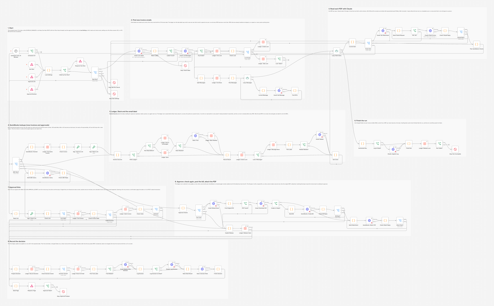
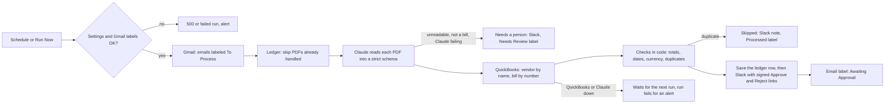
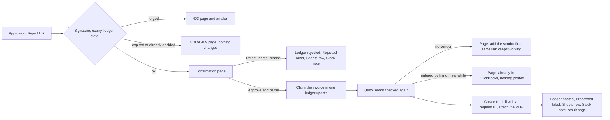
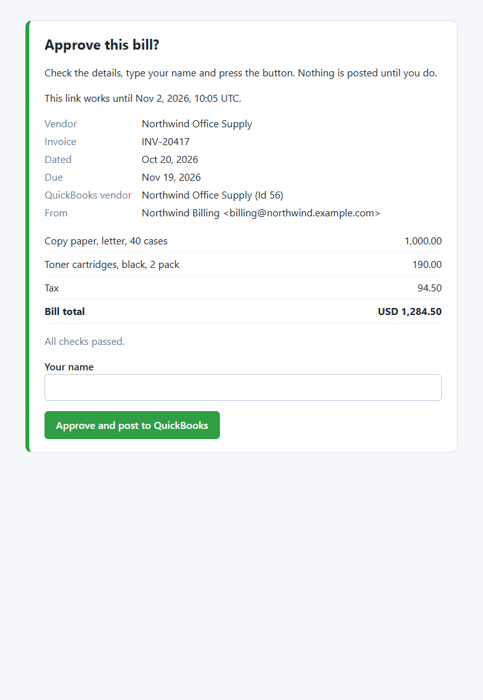

# Invoice Capture to QuickBooks: Gmail, Claude and Slack Approval

Supplier invoices that arrive by email are read by Claude, checked in code and against QuickBooks Online, approved or rejected by a person from Slack, and only then entered as QuickBooks bills with the original PDF attached. Built with n8n.



## The problem

In a small business, supplier invoices land in a shared inbox as PDFs, and the bookkeeper types each one into QuickBooks by hand: vendor, invoice number, dates, every line, the tax. It is slow, typos slip in, and the same invoice gets entered twice when a supplier sends a reminder. Handing the job to an AI tool without a check is worse: nobody sees what it read until the books are wrong. What the business wants is the reading done for them, a person saying yes before anything is posted, no duplicates, and a clear alert when something breaks.

## What this does

1. **Picks up invoice emails from a Gmail label.** Every 15 minutes it reads the emails labeled `Invoices/To Process` (a Gmail filter can add the label). An n8n data table keeps a ledger of every PDF it has seen, so an email is never read or announced twice, even when a run is repeated or crashes halfway. A lock row in the same table keeps two runs from reading the inbox at the same time.
2. **Lets Claude read each PDF.** The PDF goes to Claude as a document, and Claude answers through a forced tool call with a strict schema: vendor, invoice number, invoice and due dates, currency, the lines, subtotal, tax, total, a confidence level, and whether the document is readable at all. The answer is checked again in code before anything uses it.
3. **Checks the numbers in code.** Lines plus tax must equal the total within a cent. Required fields must be there, dates must make sense, the currency must match the vendor's, and the invoice number must fit QuickBooks' 21 characters.
4. **Checks QuickBooks before asking anyone.** It looks the vendor up by name (with optional aliases) and looks for a bill with the same number from the same vendor. A duplicate is never offered for approval: Slack is told it was skipped. The same invoice arriving in a second email is caught too.
5. **Asks a person in Slack.** Each invoice gets a Slack message with what was read, any problems in plain words, and **Approve** and **Reject** links. The links are signed per invoice (HMAC with a secret), expire after 7 days and work once. Opening a link only shows a confirmation page; the bill is posted when the person types their name and presses the button.
6. **Posts the bill on approval.** It checks QuickBooks again (was the vendor added, was the bill entered by hand meanwhile?), creates the bill with one expense line per invoice line plus a tax line, attaches the original PDF, moves the email to `Invoices/Processed`, logs a Google Sheets row and posts a Slack note. A reject records the reason and moves the email to `Invoices/Rejected`.
7. **Never guesses.** An unknown vendor still goes to Slack, clearly marked, and Approve stops until the vendor exists in QuickBooks: the workflow never creates vendors. Unreadable scans, emails without a PDF and documents that are not bills go to a person.
8. **Fails loudly.** Claude and QuickBooks calls retry with exponential backoff. An invoice that could not be finished waits for the next run, and after a few failed runs it goes to a person. Any run that could not finish everything ends as failed, and the error workflow posts the reason to Slack.

## How it works

Reading the invoices (every 15 minutes, or Run Now):



Approving (the links in Slack):



**Why an invoice is never entered twice.** Three things guard it. The ledger has one row per PDF and a repeat run skips every PDF whose row is final or waiting for approval. Before a bill is created, QuickBooks is searched for a bill with the same number from the same vendor, at intake and again when Approve is pressed. And the bill is created with a QuickBooks request ID, so a retry after a dropped connection gets the first answer back instead of a second bill. If QuickBooks saved a bill but the answer never arrived, the next press of Approve finds that bill by the ledger key in its private note and attaches the PDF to it.

**Why nothing is posted without a person.** The only path that creates a bill starts from a POST on the confirmation page, carrying a link signature that only this workflow can make (HMAC SHA-256 over the invoice key, the action and the expiry, compared in constant time). Approve first switches the ledger row from `awaiting_approval` to `approving` in one conditional update, so two clicks at the same moment cannot both post. Opening a link changes nothing, so Slack link previews and mail scanners cannot approve. Text from the PDF and the email is treated as data: Claude can only fill in fields, and no field can trigger anything the workflow does not already do.

## Workflow at a glance

| Step | Nodes | What it does |
|---|---|---|
| 1 | Schedule: Every 15 Minutes, Schedule On?, Run Now, Approval Link, Approval Decision, Load Settings, Called by Run Now?, Respond: Run Now, Start Run?, Stop: Bad Run Secret, Stop: Bad Settings | Every entry point starts at **Load Settings**, which checks every setting once. Run Now needs the `X-Run-Secret` header and answers 202, or 401, or 500 with the list of problems |
| 2 | Gmail: List Labels, Match Labels, Labels Found?, Gmail: List Messages, Stop: Gmail Failed, Any Emails?, Ledger: Find Lock, Check Lock, Lock Route, Ledger: Create Lock, Ledger: Take Lock, Lock Taken?, Split Messages | Looks the five labels up by name (Gmail changes labels by ID) and lists the emails labeled To Process, oldest first. If there are any, it takes the run lock with one conditional ledger update; while another run holds it, this run stops without touching anything |
| 3 | Ledger: Find Rows, Plan Messages, Loop: Messages, Current Message, Gmail: Get Message, Find PDFs | Reads the ledger, opens at most `MAX_MESSAGES_PER_RUN` new emails, and turns every PDF that is not handled yet into a work item |
| 4 | Loop: Work Items, Current Item, Route Item, Gmail: Get Attachment | One PDF per pass. A PDF read in an earlier run (waiting for QuickBooks, or with expired links) skips Claude |
| 5 | Build Claude Request, PDF OK?, Claude: Read Invoice, Check Claude Reply, Claude Next? | The Messages API call with the PDF and a forced strict tool. 429, 529 and 5xx retry with backoff; an unusable answer goes to a person |
| 6 | Plan QuickBooks Checks, QBO Next?, Build QBO Query, QuickBooks: Query, Check QBO Reply, QuickBooks Checked | Vendor by display name and bills by DocNumber, one query at a time, with backoff. Approvals use the same nodes |
| 7 | Ledger: Find Same Invoice, Check Invoice, Sign: Approve Link, Sign: Reject Link | The checks in code, duplicates in QuickBooks and in the ledger, and the signed links |
| 8 | Decide Outcome, Write Ledger?, Row Read Before?, Ledger: Save If Unchanged, Ledger: Save, Slack Needed?, Slack: Post, Ledger: Mark Notified, Record Result | One place picks the status. The ledger row is saved before Slack hears about it and marked once Slack accepts the message, so a request Slack refused is sent again by the next run. A row the run read at its start is only saved if nobody changed it meanwhile, so a decision made from an alert's links is never overwritten |
| 9 | Ledger: Extend Lock, Last of Message?, Ledger: Message Rows, Pick Label, Relabel Needed?, Gmail: Relabel, Item Done | Renews the run lock after every PDF, then, after the last PDF of an email, one label for the whole email |
| 10 | Summarize Run, Log to Sheet?, Sheets: Append Log, Finish Run, Ledger: Release Lock, Run Failed?, Stop: Run Incomplete | One Sheets row per invoice, then the lock is released; anything unfinished fails the run with every reason |
| 11 | Read Link, Sign: Check Link, Check Link, Link Valid?, Ledger: Find Invoice, Check Invoice State, Route Decision | Signature, expiry and ledger state; GET shows the confirmation page, POST carries out the decision |
| 12 | Ledger: Claim Invoice, Check Claim, Claimed?, Approval Checks, Can Post? | Claims the invoice, then checks QuickBooks again: vendor, currency, a bill entered by hand |
| 13 | Gmail: Reload Email, Find Original PDF, PDF Found?, Gmail: Download PDF, Create or Adopt?, Build Bill, QuickBooks: Create Bill, Check Bill Reply, Bill Next? | Fetches the PDF again and creates the bill with a request ID (or adopts a bill an earlier approval saved) |
| 14 | Build Attachment, QuickBooks: Attach PDF, Check Attach Reply, Attach Next? | The Attachable upload that links the PDF to the bill |
| 15 | Explain Release, Ledger: Release Claim | Anything that stops an approval before the bill exists puts the invoice back to waiting |
| 16 | Prepare Decision, Ledger: Record Decision, Check Decision Saved, Decision Saved?, Ledger: Rows for Email, Pick Final Label, Final Relabel?, Gmail: Relabel After Decision | The final ledger update (only from the expected state) and the email label |
| 17 | Log Decision, Log Decision to Sheet?, Sheets: Log Decision, Note Sheet Result, Slack: Decision Note, Finish Decision, Build Page, Respond: Page, Approval Failed?, Stop: Approval Problem | The Sheets row, the Slack note, the result page, and an alert for anything that went wrong |

## Statuses and labels

| Ledger status | Meaning | Gmail label |
|---|---|---|
| `awaiting_approval` | In Slack with Approve and Reject links | Invoices/Awaiting Approval |
| `approving` | Someone pressed Approve; the bill is being posted. If n8n stopped in the middle, the Approve link can finish it after 10 minutes | Invoices/Awaiting Approval |
| `posted` | The bill is in QuickBooks (the bill Id is in the row) | Invoices/Processed |
| `duplicate` | Already in QuickBooks, or the same invoice came in another email | Invoices/Processed |
| `rejected` | Rejected by a person, with the reason | Invoices/Rejected |
| `needs_review` | A person enters it by hand (the note says why) | Invoices/Needs Review |
| `retry` | Claude, QuickBooks or Gmail failed; the next run tries again | stays in Invoices/To Process |

An email with several PDFs keeps `Awaiting Approval` until every PDF is decided, and stays in `To Process` while one of its PDFs has not been read yet.

## What people see

The Slack approval request for a clean invoice (from the test run, all data made up; the links are shortened here):

```
:page_facing_up: *Invoice to approve*: Northwind Office Supply, invoice INV-20417
Total: USD 1,284.50 (lines 1,190.00 + tax 94.50)
Dated Oct 20, 2026, due Nov 19, 2026
QuickBooks vendor: Northwind Office Supply (Id 56)
- Copy paper, letter, 40 cases: 1,000.00
- Toner cartridges, black, 2 pack: 190.00
Checks: all passed
From the email from Northwind Billing &lt;billing@northwind.example.com&gt; ("Invoice INV-20417 for October")
<https://n8n.example.com/webhook/invoice-approval?k=...&a=approve&e=...&s=...|Approve and post to QuickBooks>  |  <...|Reject>
The links work until Nov 2, 2026, 09:08 UTC. Each one opens a confirmation page first.
```

An invoice with problems still goes to approval, clearly marked (Claude's own note is escaped, so `<!channel>` in a PDF cannot ping the channel):

```
:warning: *Invoice to approve, with problems*: Bluepeak Electrical, invoice BP-7781
Total: USD 820.00 (lines 750.00 + tax 60.00)
QuickBooks vendor: Bluepeak Electrical Services (Id 57)
Problems:
- Lines plus tax come to 810.00, but the invoice total is 820.00 (off by 10.00). If approved, the bill is entered as 810.00
- Claude noted: The total does not equal the lines plus tax &lt;!channel&gt;
```

Opening **Approve** shows this page (screenshot from a headless Chrome against the test setup). Typing a name and pressing the button posts the bill:



Other messages from the same test run:

```
:repeat: *Duplicate invoice skipped*: Northwind Office Supply, invoice INV-20388, USD 269.85 (lines 250.00 + tax 19.85)
QuickBooks already has this bill (Id 130, dated Oct 2, 2026). Nothing was posted.

:mag: *Invoice needs a person*: "blurry-scan.pdf" in the email from Sam Ortiz &lt;sam.ortiz@example.com&gt; ("receipt scan")
Reason: Claude could not read the PDF: The scan is too blurry to read any text or amounts.
Enter it in QuickBooks by hand. The email now has the label Invoices/Needs Review.

:white_check_mark: *Posted to QuickBooks*: Northwind Office Supply invoice INV-20417, USD 1,284.50. Bill Id 131, approved by Dana Lee.

:x: *Invoice rejected*: Metro Courier Services invoice MCS-5521, by Dana Lee. Reason: Not our account &lt;b&gt;.
```

In QuickBooks the bill has the vendor, the invoice number as bill number, both dates, one expense line per invoice line, a tax line, a private note with the approver, and the PDF in its attachments.

## Setup

**You need:** self-hosted n8n 2.x (with data tables) reachable over HTTPS, a Gmail mailbox, a QuickBooks Online company (start with a sandbox) and an Intuit developer app, an Anthropic API key, a Slack incoming webhook and, optionally, a Google Sheet for the log.

1. Create the five Gmail labels, and the ledger data table in n8n (13 columns, listed in the setup guide).
2. Create the n8n credentials: Gmail OAuth2, QuickBooks Online OAuth2 and (optional) Google Sheets OAuth2. n8n refreshes the tokens and keeps QuickBooks' rotating refresh token in its encrypted credential store.
3. Put the settings below in your n8n environment and restart n8n. The nodes read them with `$env`, so self-hosted n8n needs `N8N_BLOCK_ENV_ACCESS_IN_NODE=false`.
4. Import `workflow/error-alert-slack.json` and **activate it** (n8n 2.x only runs an active error workflow).
5. Import `workflow/invoice-capture-to-quickbooks.json`, pick your credentials on the Gmail, QuickBooks and Sheets nodes, choose the error workflow in its settings, and activate it.
6. Label one invoice email and start a run with Run Now. Approve it from Slack on the sandbox company first.

Step by step, with where every key and ID comes from: [docs/setup.md](docs/setup.md).

| Variable | Required | Where to find it |
|---|---|---|
| `QBO_REALM_ID` | yes | The QuickBooks company ID (developer dashboard for a sandbox, **Account and settings > Billing & subscription** for production) |
| `QBO_EXPENSE_ACCOUNT_ID` | yes | The expense account bills go to: the `accountId` in the address bar when you open it from the chart of accounts |
| `QBO_TAX_ACCOUNT_ID` | no | Account for the invoice's tax amount (default: the expense account) |
| `QBO_BASE_URL` | no | `https://quickbooks.api.intuit.com` (default) or `https://sandbox-quickbooks.api.intuit.com`. Must match the credential |
| `QBO_APP_URL` | no | `https://app.qbo.intuit.com` (default) or `https://app.sandbox.qbo.intuit.com`, for "Open the bill" links |
| `HOME_CURRENCY` | no | Default USD. Used when a vendor has no currency of its own |
| `VENDOR_ALIASES` | no | JSON: `{"Name printed on invoices": "QuickBooks vendor name"}` |
| `ANTHROPIC_API_KEY` | yes | console.anthropic.com > API keys |
| `ANTHROPIC_MODEL` | no | Default `claude-sonnet-5`. `claude-haiku-4-5` is cheaper, `claude-opus-5` also works. `claude-opus-5-5` and the Claude Fable and Mythos models refuse a forced tool call with thinking off, so a run refuses to start with them |
| `BUSINESS_NAME` | no | Your business name, for Claude's instructions |
| `APPROVAL_SECRET` | yes | A random string of at least 32 characters. It signs every link |
| `APPROVAL_BASE_URL` | yes | The production URL of the approval webhook: `https://YOUR-N8N-DOMAIN/webhook/invoice-approval` |
| `APPROVAL_LINK_DAYS` | no | How long links work (default 7, at most 30) |
| `SLACK_WEBHOOK_URL` | yes | Slack app > Incoming Webhooks. The error workflow posts here too |
| `LEDGER_TABLE_ID` | yes | The ID of the n8n data table (from its address bar) |
| `GOOGLE_SHEET_ID`, `GOOGLE_SHEET_TAB` | no | The spreadsheet ID from its URL and the tab name (default `Invoice log`). Leave the ID empty to skip the sheet |
| `GMAIL_LABEL_TO_PROCESS` and the other four `GMAIL_LABEL_` settings | no | Label names, if you do not use the defaults (`Invoices/To Process`, `Invoices/Awaiting Approval`, `Invoices/Processed`, `Invoices/Rejected`, `Invoices/Needs Review`) |
| `RUN_NOW_SECRET` | for Run Now | Any long random string, sent in the `X-Run-Secret` header |
| `SCHEDULE_ENABLED` | no | `false` pauses the 15 minute reading; approval links keep working |
| `MAX_MESSAGES_PER_RUN` | no | New emails opened per run (default 10, at most 50) |
| `MAX_PDF_MB` | no | Larger PDFs go to a person (default 10, at most 20, because base64 adds a third and Anthropic takes 32 MB per request) |
| `MAX_EXTRACT_ATTEMPTS` | no | Runs to retry a PDF after API failures before it goes to a person (default 3) |
| `API_MAX_ATTEMPTS`, `RETRY_BASE_SECONDS` | no | Tries per Claude or QuickBooks call in one run (default 3) and the first backoff (default 2 seconds, then 4) |
| `QBO_RATE_LIMIT_WAIT_SECONDS` | no | Wait after a QuickBooks 429 without Retry-After (default 60, as Intuit asks) |
| `DUE_DATE_MAX_DAYS`, `INVOICE_MAX_AGE_DAYS`, `BUSINESS_TZ` | no | Date checks (defaults 120 days, 365 days, `America/New_York`) |

## Testing

The workflow was tested end to end on n8n 2.19.5 against **mock Gmail, QuickBooks Online, Google Sheets, Slack and Claude APIs**, so no real account, mailbox or company was touched. The mocks keep real state (a mailbox with labels and attachments, vendors, bills, attachments, the sheet) and reject what the real APIs reject: a wrong token, Gmail label changes with unknown label IDs, QuickBooks queries the parser would refuse, bill properties that are not in Intuit's minor version 75 schema, a bill without the vendor's `CurrencyRef` in a multicurrency company, negative or malformed amounts, unknown accounts or vendors, uploads whose metadata and file part do not match, Sheets ranges and `valueInputOption` values, and Messages API requests that are malformed or break the strict tool rules. The PDFs are fictional invoices made for the test.

In the test, n8n's OAuth credentials are replaced by fixed bearer tokens, because the mocks cannot run Google's or Intuit's OAuth flow. Token refresh itself is n8n's own code and was not exercised. The real Claude request was also checked against Anthropic's free token counting endpoint, which validates the PDF block, the strict tool schema and the forced tool call without generating anything. A headless Chrome opened an approval link, typed a name and pressed the button, to confirm the form works with n8n's sandboxed HTML pages.

All 83 checks across 53 scenarios pass:

| Scenario | Result |
|---|---|
| Clean invoice, end to end | Read, checked, Slack request with signed links, email moved to Awaiting Approval. Approve shows a confirmation page, then posts the bill (lines, tax line, dates, bill number, private note), attaches the PDF, marks the ledger posted, labels the email Processed, logs to Sheets and Slack |
| Duplicate invoice number | Same vendor and number already in QuickBooks: no links, Slack says it was skipped, nothing posted |
| Total mismatch | Goes to approval with the difference spelled out; approved, it is posted as read and the warning is kept in the bill's note |
| Unknown vendor | Goes to approval marked "not found"; Approve refuses and keeps the link working; after the vendor is added, the same link posts the bill. No vendor is ever created |
| Unreadable scan, no PDF, no tool call from Claude | Go to a person with the reason, labeled Needs Review |
| Rejected invoice | Nothing posted, reason logged, email labeled Rejected, Approve link refused afterwards |
| Forged links | A changed signature, or a Reject link turned into Approve, is refused with 403 and raises an alert |
| Reused, expired and incomplete links | 409 (shows what happened), 410 (explains how to get new links) and 400; nothing changes |
| Two clicks at the same moment | One bill; the other click is told the invoice is already being handled |
| An approval that stopped halfway | After 10 minutes Reject refuses and Approve finishes it, with one bill |
| Two runs at once | While another run holds the lock, a run lists the emails and stops; the lock is renewed after every PDF and released at the end of every run |
| Repeat runs | Nothing handled is read or announced again; only unfinished PDFs are touched, from their saved reading |
| Two PDFs in one email | The email stays in To Process while one PDF has no ledger row, the next run reads only that PDF, and the email moves on once both are decided |
| No currency on the invoice | Treated as the vendor's currency, with a warning in Slack |
| QuickBooks 429 | At intake and on the bill create: waits for Retry-After and succeeds; the bill create keeps its request ID, so there is one bill |
| QuickBooks 401 | Not retried; the invoice waits with its reading saved; the run fails with "reconnect the QuickBooks credential"; the next run finishes it without Claude |
| Claude down (529) | Three tries with backoff, the PDF waits for the next run; after two failed runs it goes to a person |
| QuickBooks saved the bill but the answer was lost | Three tries with one request ID, the invoice waits; Approve again finds that bill and attaches the PDF: still one bill |
| PDF without a filename | Found again at approval by its Gmail part ID and attached as `invoice.pdf` |
| Bill entered by hand while waiting | Approve finds it and posts nothing |
| PDF upload fails after the bill was created | The bill stays; the page, the ledger and an alert say to attach the PDF by hand |
| Gmail label change fails, Slack down | Retried 3 times; the ledger keeps the result and the run fails (with the approval links in the alert). The next run fixes the label and sends the Slack request again, once |
| Approved from the alert's links while the next run sends the request again | The run saves nothing over the decision: the row stays posted, Slack is not asked again, the email moves to Processed |
| Vendor in another currency | An EUR invoice for a vendor set up in EUR goes to approval and is posted with `CurrencyRef` EUR |
| Expired links | Moving the email back to To Process posts new links without calling Claude again |
| Settings broken, wrong Run Now secret | 500 with every problem, or 401, and an alert; approval links show a "not set up" page |
| Schedule on and off | Off: does nothing. On: picks up a new email by itself and catches it as a duplicate of an invoice already posted |
| Error alert workflow | Every failed run raised exactly one Slack alert linked to it, with the reasons escaped for Slack |

Full results, the requests the workflow sent and the docs they were checked against: [docs/test-report.md](docs/test-report.md). Run the same tests with [tests/e2e_mock_test.py](tests/e2e_mock_test.py). What testing found and fixed is in [CHANGELOG.md](CHANGELOG.md).

## What it handles when things go wrong

| Situation | What happens |
|---|---|
| A setting is missing or wrong | Run Now answers 500 with every problem; a scheduled run fails with the same list; approval links show a page that says approvals are not set up. No email is read |
| Claude is overloaded or rate limited | Up to 3 tries per PDF with exponential backoff (Retry-After honored). Still failing: the PDF stays in To Process and the next run tries again; after `MAX_EXTRACT_ATTEMPTS` runs it goes to a person |
| Claude answers without the tool call, or runs out of tokens | The PDF goes to a person. Nothing is guessed |
| QuickBooks rate limit (429) | Waits Retry-After, or 60 seconds as Intuit asks, then tries again |
| QuickBooks is down (5xx) or a connection drops | Backoff and retries. At intake the invoice waits for the next run with its reading saved; on approval the invoice goes back to waiting and the page says to try again |
| QuickBooks token revoked (401) or no permission (403) | Not retried. The run fails with what to fix (reconnect the credential, use an admin user, check the realm ID); invoices wait and finish on the next run after the fix |
| QuickBooks saved the bill but the answer never arrived | The bill create carries a request ID, so retries get the first answer. If the answer is lost for good, the next Approve finds that bill by the ledger key in its note and attaches the PDF, instead of creating a second bill |
| The PDF cannot be attached | The bill stays. The page, the ledger note, the Slack note and an alert say to attach it by hand |
| A Gmail label change fails | The ledger already has the result; the next run sees the email still in To Process and only fixes the label |
| Slack does not accept the approval request | Retried 3 times; the invoice is saved as waiting, and the run fails with the Approve and Reject links in the alert. The next run sends the request again, marked as sent again |
| Someone uses the links in that alert while the next run is sending the request again | The run saves its row only if the row is still as it read it, so the decision stands: nothing is overwritten and Slack is not asked again |
| Someone forges, edits or reuses a link | Forged or edited: 403 and an alert. Reused: 409 with what happened. Expired: 410 |
| Two people press Approve at the same moment | The ledger claim is a single conditional update; the second press is told the invoice is being handled |
| n8n stops in the middle of an approval | The invoice stays `approving`. After 10 minutes its Approve link offers to finish the job: QuickBooks is searched first, so a bill that was already saved is adopted, not created again. Its Reject link refuses, because the bill may already exist; the page says to finish with Approve and delete the bill in QuickBooks if it should not be there |
| Two runs start at the same time (schedule and Run Now) | The run lock lets one read the inbox; the other stops at once. The lock is renewed after every PDF, so a slow run keeps it. A lock left by a crashed run runs out after 30 minutes |
| The vendor is not in QuickBooks | Marked in Slack; Approve stops and says to add the vendor (or an alias). The workflow never creates one |
| Text in a PDF or email tries to give instructions | It is data inside tags and a document block. Claude can only fill in the invoice fields, which are checked in code; text sent to Slack is escaped, and the HTML pages escape everything they show |

## Cost

Each invoice is one Claude call. For a one page invoice, Anthropic's token counter measured about 3,860 input tokens on `claude-sonnet-5` (3,500 on `claude-haiku-4-5`), and the answer is usually under 300 tokens. At $2 per million input tokens and $10 per million output tokens that is about one cent per invoice on `claude-sonnet-5`. Longer PDFs cost more: Anthropic counts each page as text plus an image. Gmail, Google Sheets and Slack calls are free within their quotas; QuickBooks API calls count toward Intuit's monthly allowance for your app tier.

## Limitations and next steps

- Request shapes follow the official docs and were tested against mocks only. Run it on a QuickBooks sandbox company before production. The Attachable upload sends the PDF as a raw binary multipart part with its own `application/pdf` type. Intuit's written example shows the file part base64 encoded, but Intuit's own Java SDK sends the raw bytes with no `Content-Transfer-Encoding` header, which is the same form; it is still worth seeing the first attachment arrive on the sandbox.
- Tax is posted as one expense line on `QBO_TAX_ACCOUNT_ID`. That fits US companies, where purchase tax is an expense. Companies that reclaim VAT or GST need tax codes on each line (`TaxCodeRef`, `GlobalTaxCalculation`), which this version does not set.
- Invoice lines go to one expense account. Mapping lines to accounts, classes or locations (or using item based lines) is a next step.
- Bills use the vendor's currency (sent as `CurrencyRef`, which QuickBooks requires when multicurrency is on; no exchange rate is sent, so QuickBooks uses the one from its currency center), and an invoice in another currency than the vendor's is blocked for a person. An invoice that prints no currency is treated as the vendor's (or the home currency) with a warning in Slack. US QuickBooks companies accept ISO-8859-1 text only, so a line description in another script may be refused.
- Vendors are matched by display name, with optional aliases. A fuzzy match (for example on the vendor's tax ID or email) is a next step.
- Negative lines (discounts, credits) cannot go on a QuickBooks bill, so such invoices are blocked for a person. Credit notes are recognized and sent to a person, not entered as vendor credits.
- If n8n stops in the middle of a run, the lock holds the inbox for up to 30 minutes before the next run can read it. The lock is renewed after every PDF, so only a single PDF whose calls take more than 30 minutes in total (every Claude and QuickBooks retry timing out) could let the next run start while it is still working. That run would send a second approval request for the same invoice; a second bill is still prevented by the ledger claim and the QuickBooks checks.
- The `X-Run-Secret` header of a Run Now call is kept in that execution's data, like every webhook header. Anyone who can read executions in n8n can see it.
- Every forged link and every failed run posts an alert. Someone who keeps sending forged links can flood the Slack channel, so rate limit the webhook path at your proxy.
- One run reads up to 100 emails from the label and opens at most `MAX_MESSAGES_PER_RUN` new ones; the rest wait for later runs.
- n8n keeps each execution's data, and these executions contain the PDFs (base64). Set n8n's execution pruning (`EXECUTIONS_DATA_PRUNE`, `EXECUTIONS_DATA_MAX_AGE`) to keep the database small.
- Anyone who can open the approval links can approve; the name on the page is typed, not verified. Post the requests in a private Slack channel.
- Settings are environment variables and the Claude key is read with `$env`. On n8n Cloud, use Variables (`$vars.`) instead; for production you may prefer to move the Anthropic key into an n8n credential.

## About

Built by **Romiel Inolino**, AI and CRM Automation Specialist working with GoHighLevel, Monday.com, ClickUp, n8n, Make and Zapier.
Portfolio and case studies: [romielwillautomate.dev](https://romielwillautomate.dev)

This repository is a portfolio implementation. Credentials, API keys and customer data are not included, and all test data is made up.
